<p align="center">
  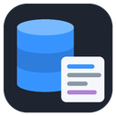
</p>

<h1 align="center">SQL Notebook Studio</h1>

<p align="center">
  <b>Jupyter-style SQL notebooks for VS Code.</b><br>
  Write SQL in cells, see results in a fast grid, chart them in one click, and let AI write, fix and explain your queries.
</p>

<p align="center">
  <a href="https://marketplace.visualstudio.com/items?itemName=kgptalkie.sql-notebook"></a>
  <a href="https://marketplace.visualstudio.com/items?itemName=kgptalkie.sql-notebook"></a>
  <a href="https://marketplace.visualstudio.com/items?itemName=kgptalkie.sql-notebook&ssr=false#review-details"></a>
  <a href="https://github.com/laxmimerit/sql-notebook-studio/stargazers"></a>
  <a href="LICENSE"></a>
  
</p>

<p align="center">
  
  
  
  
  
  
  
  
</p>

<p align="center">
  <a href="#install">Install</a> ·
  <a href="#quick-start">Quick start</a> ·
  <a href="#features">Features</a> ·
  <a href="#connect-to-a-database">Connect</a> ·
  <a href="#ai">AI</a> ·
  <a href="#settings">Settings</a> ·
  <a href="#faq">FAQ</a>
</p>

<p align="center">
  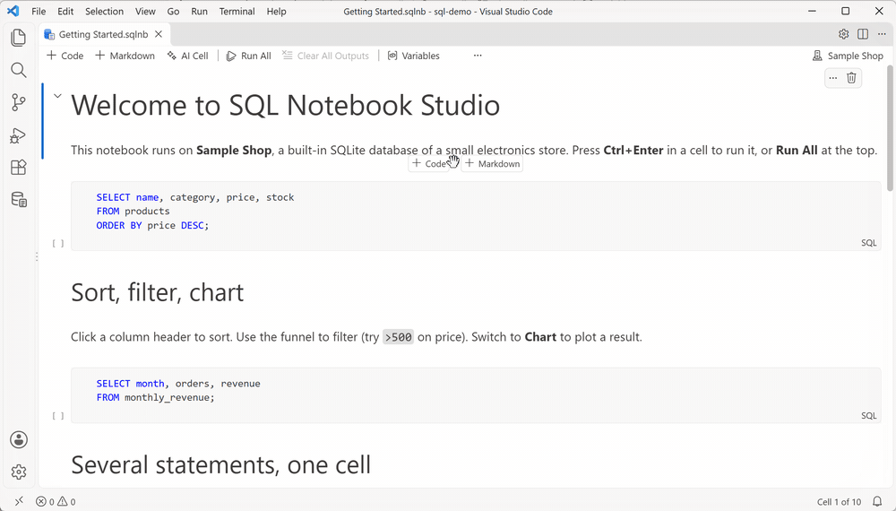
</p>

---

## Why SQL Notebook Studio

- **One notebook for every database.** MySQL, MariaDB, PostgreSQL and SQL Server. SQLite and DuckDB are built in, so you can start with no server at all.
- **Results you can work with.** A virtual grid that stays fast with 10,000+ rows. Sort, filter, copy, export, and switch to a chart in one click.
- **AI that knows your schema.** Write SQL from plain words, fix errors, optimize slow queries and explain results. Use OpenAI, Anthropic, OpenRouter or a local model through Ollama.
- **Plain-text notebooks.** `.sqlnb` files are readable SQL, so they diff and review well in Git.
- **Safe by default.** Passwords stay in VS Code's secret storage. Production connections confirm every write. Read-only connections block them.

## Install

**From the Marketplace:** search for **SQL Notebook Studio** in the Extensions view, or run:

```bash
code --install-extension kgptalkie.sql-notebook
```

**From a file:** download the `.vsix` for your system, then in VS Code open **Extensions → ··· → Install from VSIX…**

## Quick start

1. Open the **SQL Notebook Studio** view in the activity bar.
2. Click **Open Sample Notebook**. It uses a small shop database that ships with the extension.
3. Press **Run All**, or **Ctrl+Enter** in a cell.

To make your own notebook, run **SQL Notebook Studio: New SQL Notebook**, or right-click a `.sql` file and choose **Open as SQL Notebook**.

## Features

| | |
| --- | --- |
| **Notebooks** | SQL, Markdown and AI cells. Several statements per cell, each with its own result tab. Stop works on every database. |
| **Results grid** | Virtual scrolling, sort (Shift+click for more columns), filter per column (`>10`, `a..b`, `!x`, `null`), resize and pin columns, value viewer for long text and JSON. |
| **Charts** | Bar, line, area, scatter and pie. Pick X and Y, stack series, save the chart with the cell. |
| **Explorer** | Connections, schemas, tables, views and columns with types and keys. Select Top 100 and Describe in one click. |
| **Autocomplete** | Tables, views, columns, schemas and keywords from the live schema. `alias.` lists that table's columns. |
| **Variables** | `{{name}}` asks for a value once per session. `${env:NAME}` reads an environment variable. |
| **Export** | Copy as TSV, CSV, Markdown or JSON. Export results to CSV or JSON, and notebooks to HTML (with charts), PDF or Markdown. |
| **Safety** | Confirms `DROP`, `TRUNCATE`, and `UPDATE` or `DELETE` without `WHERE`. Production tags and read-only connections. |

<p align="center">
  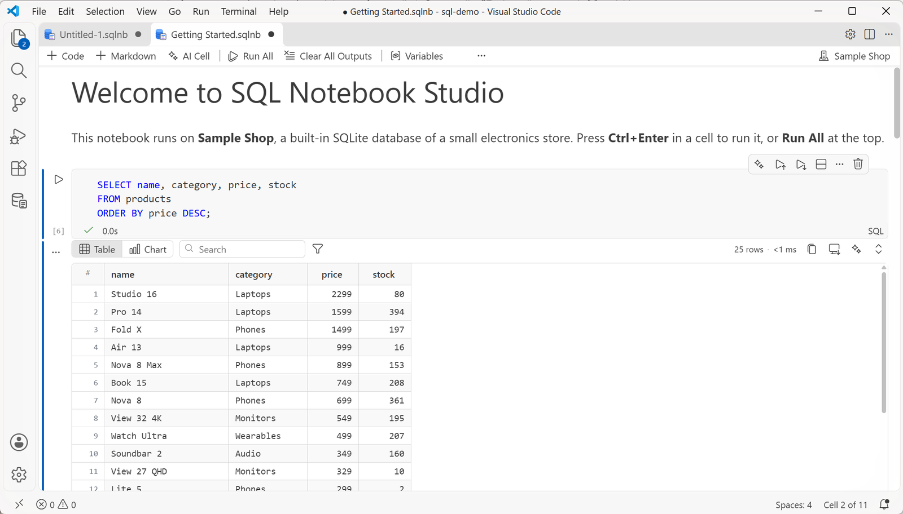
</p>

<p align="center">
  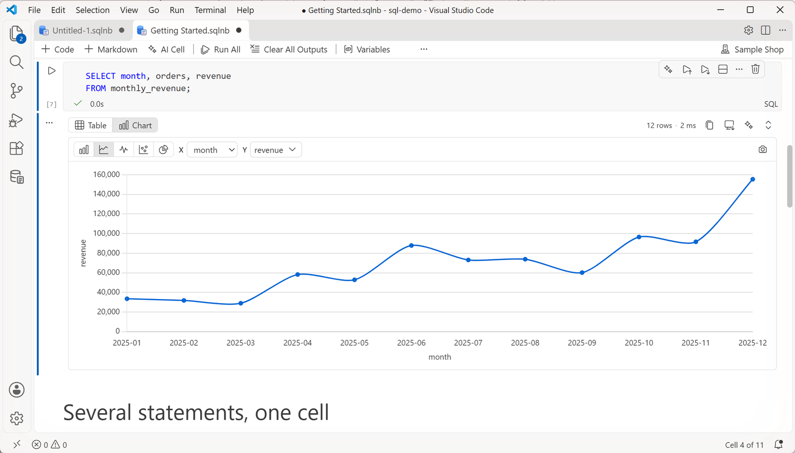
</p>

### Autocomplete

<p align="center">
  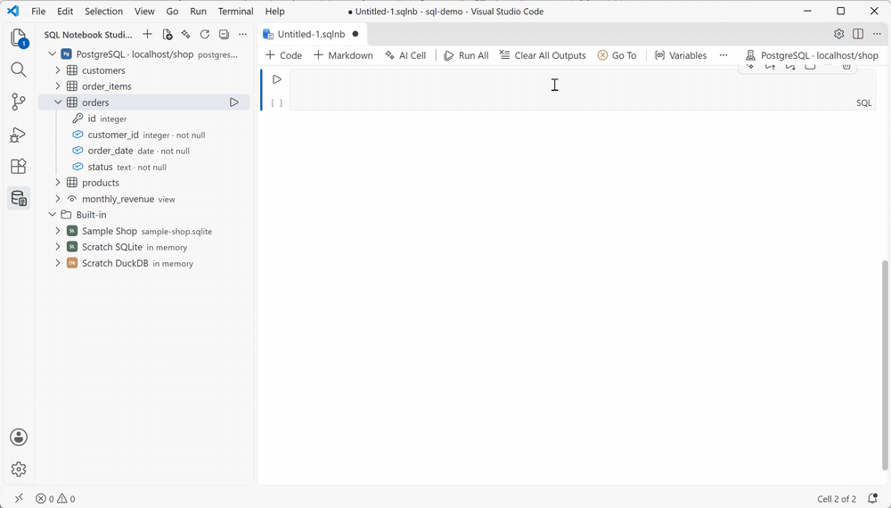
</p>

## Connect to a database

Click **+** in the view and fill in the form. Or click **Paste connection string**: if you already copied one, it is filled in for you.

<p align="center">
  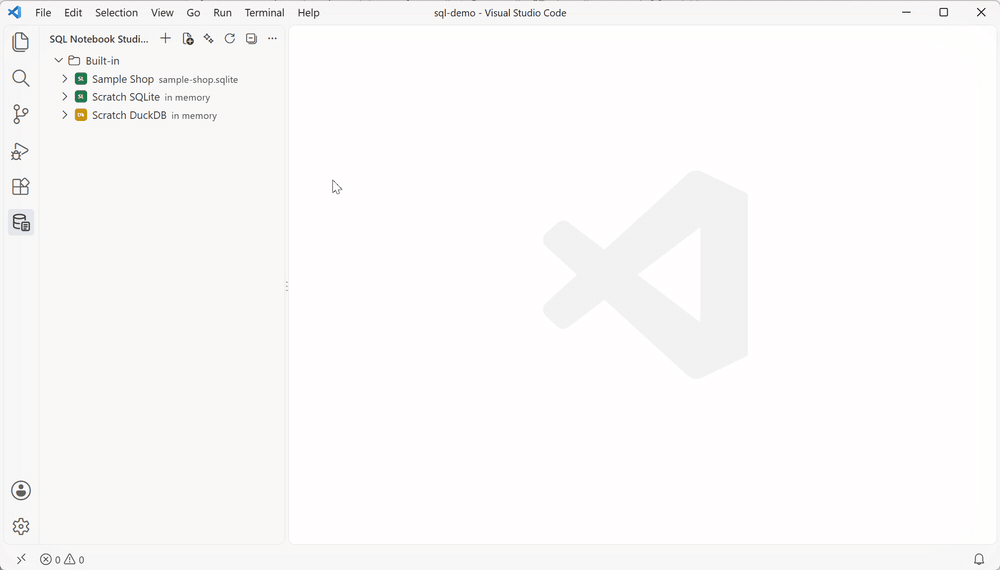
</p>

| Database | Notes |
| --- | --- |
| **MySQL / MariaDB** | SSL/TLS, SSH tunnel |
| **PostgreSQL** | SSL/TLS, SSH tunnel |
| **SQL Server** | SQL login, Windows (NTLM) or Microsoft Entra ID |
| **SQLite** | Built in. A file or in memory |
| **DuckDB** | Built in. A file or in memory. Query CSV and Parquet directly |

- SSL/TLS with CA, client certificate and key.
- SSH tunnel with password, key file or SSH agent.
- Connection strings: `mysql://`, `postgres://`, `Server=…;Database=…`, or a file path.
- Each notebook remembers its connection. A single cell can use another one from its status bar.

<table>
  <tr>
    <td>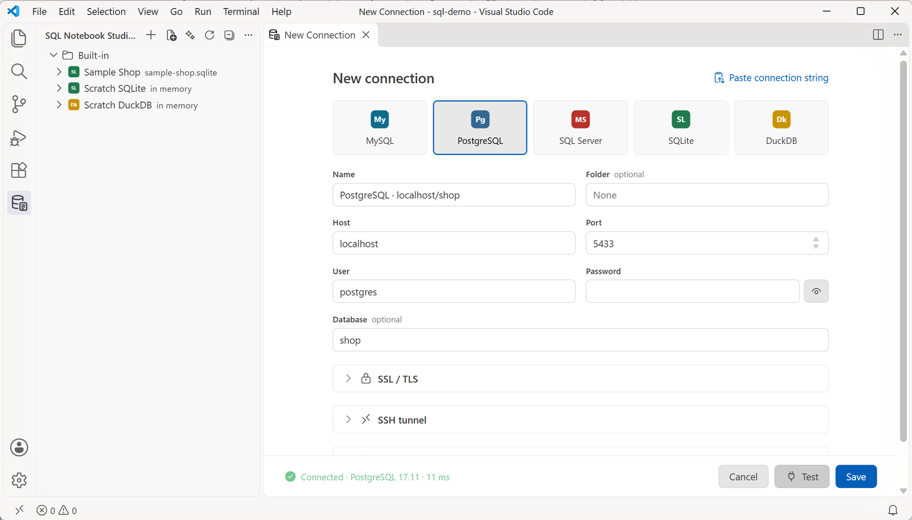</td>
    <td>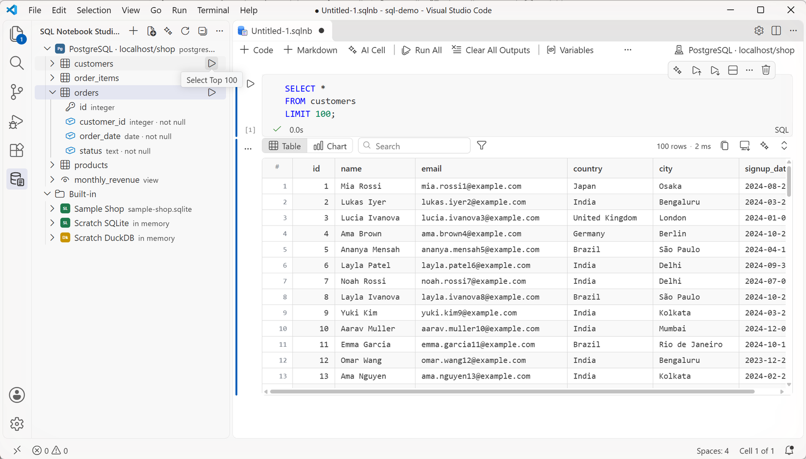</td>
  </tr>
</table>

## AI

AI is optional and off until you set it up: run **SQL Notebook Studio: Configure AI**. It works through [LangChain](https://js.langchain.com/), so every provider behaves the same.

| Provider | What you need |
| --- | --- |
| OpenAI | API key |
| Anthropic | API key |
| OpenRouter | API key |
| Ollama | Ollama running locally. No key, nothing leaves your machine |
| Custom | Any OpenAI-compatible URL |

| Feature | What it does |
| --- | --- |
| **AI cell** | Write what you want in plain words. The SQL appears in the next cell, ready to run. |
| **Fix with AI** | On an error, shows the cause and a corrected query. Apply it in one click. |
| **Explain** | Explains a query step by step. |
| **Optimize** | Reads the query plan and suggests a faster query or an index. |
| **Explain result** | Summarizes what the rows show. Asks before it sends any rows to a cloud provider. |

Only the schema (table and column names) is sent with your request, unless you allow result data.

### AI cell: plain words in, SQL out

<p align="center">
  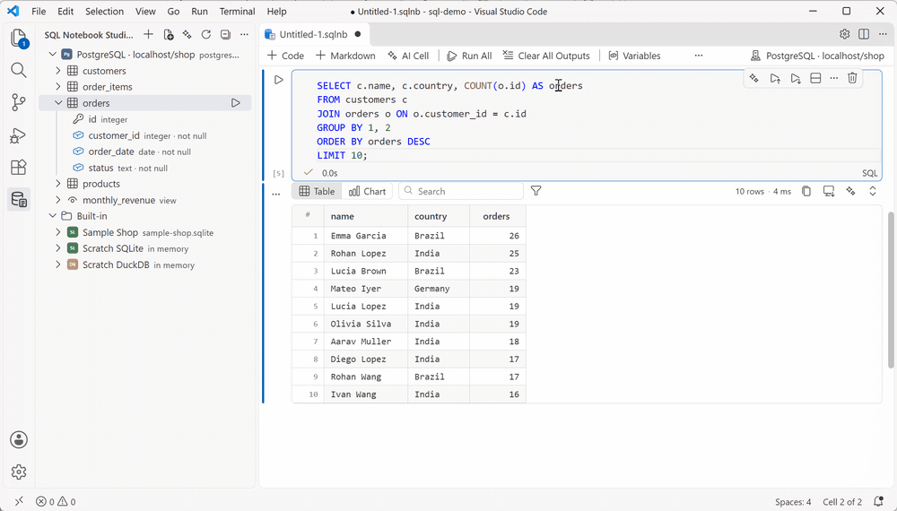
</p>

### Fix an error, then explain the result

<p align="center">
  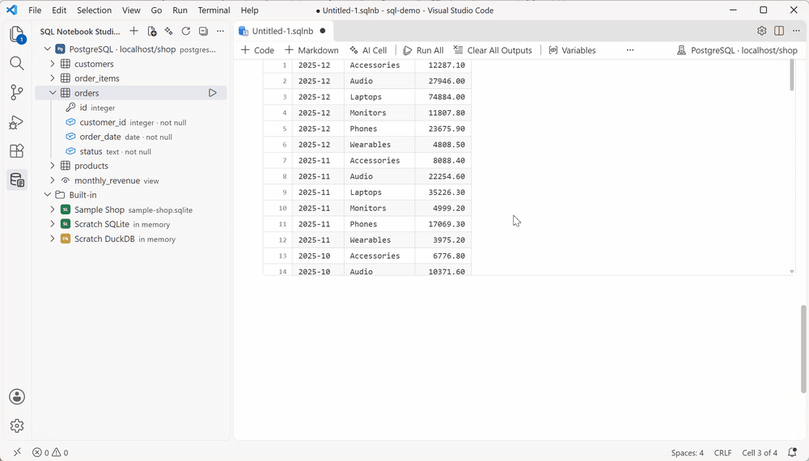
</p>

<table>
  <tr>
    <td>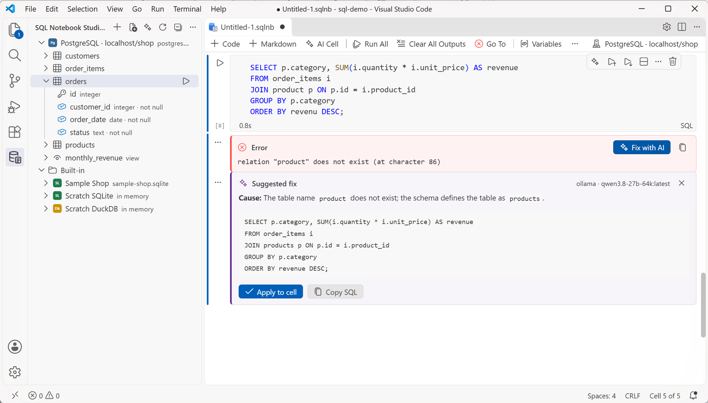</td>
    <td>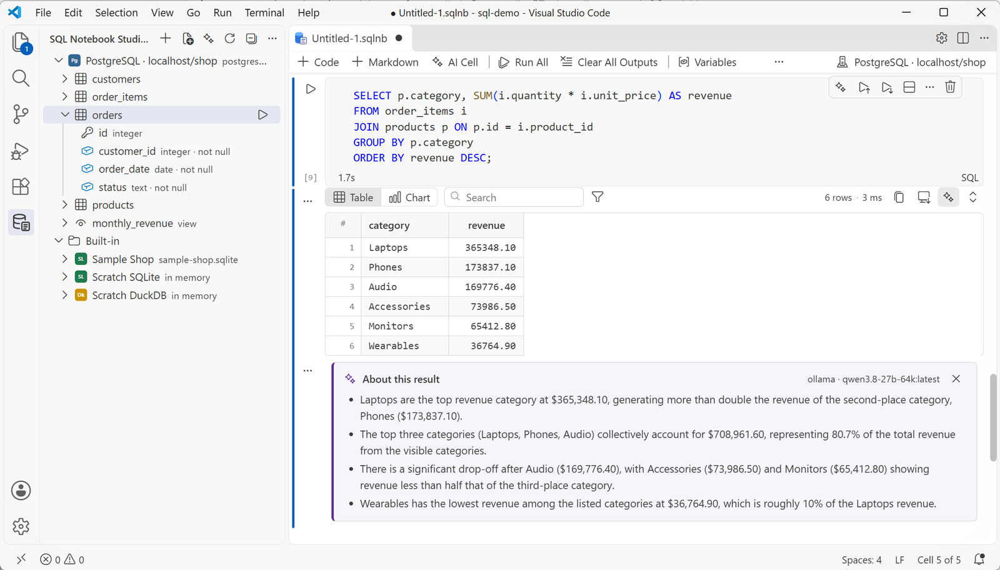</td>
  </tr>
</table>

## The `.sqlnb` format

A notebook is plain SQL with comment markers, so it reads well in any editor and in a Git diff:

```sql
-- sqlnb v1 {"connection":"Sample Shop"}
-- %% md
-- ## Top products
-- %% sql
SELECT name, price
FROM products
ORDER BY price DESC;
```

## Settings

| Setting | Default | What it does |
| --- | --- | --- |
| `sqlNotebook.results.maxRows` | `10000` | Rows kept per result |
| `sqlNotebook.queryTimeoutSeconds` | `0` | Query timeout. `0` means none |
| `sqlNotebook.saveResults` | `false` | Save results in the notebook file |
| `sqlNotebook.confirmDestructive` | `production` | When to confirm risky statements |
| `sqlNotebook.export.maxRows` | `500` | Rows per result in exported files |
| `sqlNotebook.ai.provider` | `openai` | AI provider |
| `sqlNotebook.ai.model` | | Model name, for example `qwen3.8:27b` for Ollama |
| `sqlNotebook.ai.baseUrl` | | Custom or Ollama URL |
| `sqlNotebook.ai.allowResultData` | `false` | Send rows to AI without asking |
| `sqlNotebook.ai.runGeneratedSql` | `false` | Run SQL from an AI cell at once |

## FAQ

**Do I need a database server to try it?**
No. The sample notebook runs on the built-in SQLite. DuckDB is built in too.

**Where are my passwords stored?**
In VS Code's secret storage (your OS keychain). Never in settings or in the notebook file.

**Can I use AI without sending data to the cloud?**
Yes. Choose **Ollama** and run a local model. Nothing leaves your machine.

**Can I open my existing `.sql` files?**
Yes. Right-click a `.sql` file and choose **Open as SQL Notebook**. Each statement becomes a cell.

**Which platforms are supported?**
Windows, macOS and Linux (x64 and arm64), including Alpine.

## Development

```bash
npm install
npm run build        # bundle the extension, renderer and webview
npm test             # unit and driver tests
npm run package:all  # one .vsix per platform in vsix/
```

Press **F5** in VS Code to start an Extension Development Host.

## Contributing

Bug reports and ideas are welcome in [Issues](https://github.com/laxmimerit/sql-notebook-studio/issues). For a pull request, please open an issue first so we can agree on the change.

## License

[Apache License 2.0](LICENSE) © 2026 KGP Talkie

You can use, change and share this code, also in commercial work. If you publish it, or a work based on it, keep the [NOTICE](NOTICE) file with it and credit **SQL Notebook Studio by KGP Talkie** with a link to this repository.

Third-party software included in the extension is listed in [THIRD-PARTY-NOTICES.txt](THIRD-PARTY-NOTICES.txt).

### Trademarks

The license covers the code, not the names. "SQL Notebook Studio", "KGP Talkie" and the SQL Notebook Studio logo are not licensed for use by forks. If you publish a fork, give it your own name and logo.

<p align="center">
  Made by <a href="https://www.youtube.com/kgptalkie">KGP Talkie</a> · If it helps you, please ⭐ the repo and rate it on the <a href="https://marketplace.visualstudio.com/items?itemName=kgptalkie.sql-notebook&ssr=false#review-details">Marketplace</a>.
</p>
