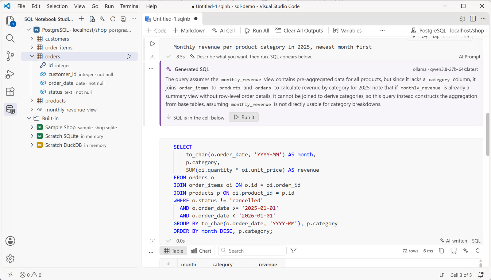

# SQL Notebook Studio

Write SQL in notebooks, the way you use Jupyter. Run one cell or all of them, see results in a fast grid, turn them into a chart, and ask AI to explain or fix a query.

Works with **MySQL / MariaDB**, **PostgreSQL** and **SQL Server**. **SQLite** and **DuckDB** are built in, so you can start with no server at all.

## Start in 30 seconds

1. Open the **SQL Notebook Studio** view in the activity bar.
2. Click **Open Sample Notebook**. It uses a small shop database that ships with the extension.
3. Press **Run All**.

To use your own database, click **+** in the view and fill in the form, or paste a connection string.

## Notebooks

- `.sqlnb` files are plain text, so they diff well in Git.
- SQL, Markdown and AI cells. A SQL cell works with every database: the connection picks the dialect.
- Results can be saved in the file (`sqlNotebook.saveResults`).
- Several statements per cell. Each one gets its own result tab.
- The kernel picker is the connection picker. A cell can use a different connection from its status bar.
- `{{name}}` variables ask for a value once per session. `${env:NAME}` reads an environment variable.
- Stop works on every database.

## Results

- Virtual grid that stays fast with 10,000+ rows.
- Sort (Shift+click for more columns), filter per column (`>10`, `a..b`, `!x`, `null`), resize and pin columns.
- Copy as TSV, CSV, Markdown or JSON. Export to CSV or JSON.
- Double-click a cell to see long text or JSON in full.
- **Chart**: bar, line, area, scatter or pie in one click. The chart is saved with the cell.

## Connections

- SSL/TLS with CA, client certificate and key.
- SSH tunnel with password, key file or SSH agent.
- SQL Server: SQL login, Windows (NTLM) or Microsoft Entra ID.
- Passwords live in VS Code's secret storage, never in settings.
- Tag a connection as **production** to confirm every write, or make it **read-only**.

The explorer shows tables, views and columns with their types. Click ▷ on a table to run Select Top 100.

## Autocomplete

Tables, views, columns, schemas and keywords, from the live schema. `alias.` lists the columns of that table.

## AI

AI is optional and off until you set it up: **SQL Notebook Studio: Configure AI**.

| Provider | What you need |
| --- | --- |
| OpenAI | API key |
| Anthropic | API key |
| OpenRouter | API key |
| Ollama | Ollama running locally (no key) |
| Custom | Any OpenAI-compatible URL |

What it does:

- **Explain** a query, **Optimize** it (uses the query plan), **Fix** an error.
- **Explain result**: asks before it sends any rows.
- **AI cell**: write what you want in plain words and it writes the SQL in the next cell.

Only the schema (table and column names) is sent, unless you allow result data.

### AI cell: plain words in, SQL out

### Fix an error, explain a result

## Export

HTML (with charts), PDF and Markdown, from the notebook toolbar.

## Settings

| Setting | Default | |
| --- | --- | --- |
| `sqlNotebook.results.maxRows` | 10000 | Rows kept per result |
| `sqlNotebook.queryTimeoutSeconds` | 0 | 0 means no timeout |
| `sqlNotebook.saveResults` | false | Save results in the file |
| `sqlNotebook.confirmDestructive` | production | When to confirm risky statements |
| `sqlNotebook.ai.allowResultData` | false | Send rows to AI without asking |
| `sqlNotebook.ai.runGeneratedSql` | false | Run SQL from an AI cell at once |

## License

MIT
